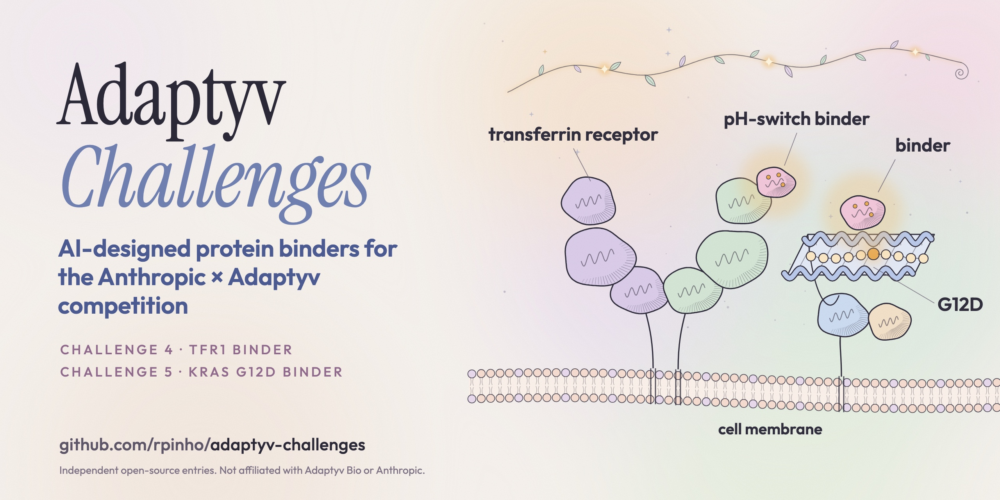

# adaptyv-challenges

Part of my AI-for-biology work: [the map and the field retro](https://github.com/rpinho/ai-biology).

Track 3 entries for **Challenges 4 and 5** of the
[Anthropic x Adaptyv Protein Design Competition](https://proteinbase.com/competitions/anthropic-adaptyv-2026).

## Challenge 4: TfR1 pH-switch binder

**Target:** human transferrin receptor 1 (TfR1, UniProt P02786) — a pH-sensitive
conditional binder for blood-brain barrier transcytosis.

**Design criteria** (from the challenge specification):
- Bind at pH 7.4, no detectable binding at pH 6.0
- Mouse TfR1 (Q62351) cross-reactivity preferred
- Single-chain, 10-250 amino acids

**Method:** Proton-coupled two-state binder design using RFdiffusion-Proteina
with histidine-enriched sequence conditioning, scored by Wyman linkage
analysis (PROPKA3 pKa shifts across pH). Candidates screened through
a multi-stage pipeline: geometric metrics at generation time, structural
novelty via Foldseek/TM-align against PDB + patent databases, restored-context
clash audit against the full receptor, and mouse epitope conservation analysis.

See [METHOD.md](METHOD.md) for the full C4 technical description.

## Challenge 5: KRAS G12D pMHC binder

**Target:** KRAS G12D peptide VVVGADGVGK presented on HLA-A*11:01 with beta-2-microglobulin (reference structures PDB 7OW6 and 7OW5, TCR removed).

**Design criteria** (from the challenge specification):
- Bind the G12D pMHC complex (mutation specificity over wild-type VVVGAGGVGK)
- Don't bind peptide-free HLA+B2M (peptide dependence)
- High affinity
- Single-chain, 10-250 amino acids

**Method:** BoltzGen (JapanFold API) generating single-chain binders at 55-250 aa, scored with three independent models (OpenDDE-AbAg, Boltz-2, OpenFold3) against all three conditions. About 18,000 design jobs across 140 rounds, plus RFD4-Proteina and nanobody/antibody protocols. Portfolio selected by cross-model consensus: designs ranked by agreement across all three scorers rather than optimization of any single one.

The first ~80 rounds scored against the wrong HLA allele (A*02:01 instead of A*11:01). Found the error from our own day-one capture of the challenge page. Rescored all 140 eligible designs against the correct target. The wrong-target story is the most useful part of this entry. See [RETRO.md](RETRO.md).

v27 submitted November 9 (final). 20 designs, 59-250 aa. The top design is the only one out of 735 tested that shows positive mutation specificity on all three scoring models (Boltz-2 +0.091, OpenFold3 +0.079, OpenDDE-AbAg +0.244). The previous top-ranked design by single-scorer (OpenDDE-AbAg +0.285) shows negative delta on both Boltz-2 and OpenFold3 — a scorer-specific artifact. All designs bind peptide-free HLA. Candidate; lab results not out.

## Running

### C4

```bash
python -m venv .venv && source .venv/bin/activate
pip install -e ".[all-cuda13]"  # or .[all-cpu] for local work

# CPU dry run (validates the spec, costs cents)
python modal_rfd4.py dry_run

# Generate 200 designs with inline geometric metrics
modal run modal_rfd4.py::generate --num-replicates 200 --batch-size 8 \
    --out-name tfr1_run --metrics geom

# CPU novelty screen
python scripts/run_cpu_novelty.py input.csv --databases databases.json \
    --structures structures.json
```

Requires a [Modal](https://modal.com) account for GPU generation and a local
install of [Foldseek](https://github.com/steineggerlab/foldseek) for structural
novelty screening.

### C5

```bash
# Verify the target sequences against the challenge page capture
python3 scripts/c5_target.py

# Run a design round (design -> harvest -> score all 3 targets)
python3 scripts/c5_round.py --round N --length-min 230 --length-max 250
```

Requires a JapanFold API key at `~/.config/japanfold/key`.

## References

Every component of the pipeline is someone else's tool or model:

- [RFD4-Proteina](https://github.com/RosettaCommons/RFD4-Proteina) (Baker Lab x NVIDIA GenAIR) — C4 backbone generation under histidine-enriched conditioning; descends from [RFdiffusion](https://github.com/RosettaCommons/RFdiffusion) ([Watson et al. 2023](https://doi.org/10.1038/s41586-023-06415-8)).
- [BoltzGen](https://github.com/jwohlwend/boltz) via JapanFold API — C5 binder generation with epitope conditioning.
- [ProteinMPNN](https://github.com/dauparas/ProteinMPNN) and [LigandMPNN](https://github.com/dauparas/LigandMPNN) ([Dauparas et al. 2022](https://doi.org/10.1126/science.add2187)) — C4 sequence design on generated backbones.
- [OpenDDE-AbAg](https://github.com/adaptyvbio/binder-prescreen) via JapanFold API — C5 antibody-antigen confidence scoring.
- [AlphaFold2-multimer](https://github.com/google-deepmind/alphafold) ([Jumper et al. 2021](https://doi.org/10.1038/s41586-021-03819-2)) via [ColabFold](https://github.com/sokrypton/ColabFold) ([Mirdita et al. 2022](https://doi.org/10.1038/s41592-022-01488-1)), [ESMFold](https://github.com/facebookresearch/esm) and [Boltz-2](https://github.com/jwohlwend/boltz) — complex prediction and confidence scores.
- [PROPKA3](https://github.com/jensengroup/propka) ([Olsson et al. 2011](https://doi.org/10.1021/ct100578z)) — pKa shifts for C4 pH claims; [PDB2PQR](https://pdb2pqr.readthedocs.io/en/stable/using/index.html) for structure preparation.
- Wyman linkage ([Wyman 1964](https://doi.org/10.1016/S0065-3233(08)60190-4)) — how pKa shifts become a pH-conditional binding score.
- [Foldseek](https://github.com/steineggerlab/foldseek) and [TM-align](https://zhanggroup.org/TM-align/) — structural novelty screening against the [PDB](https://www.rcsb.org/) and patent structures.
- [Modal](https://modal.com) — C4 GPU compute. [JapanFold](https://japanfold.aiand.com) — C5 design and scoring API. Target sequences from [UniProt](https://www.uniprot.org/).
- PDB [7OW6](https://www.rcsb.org/structure/7OW6) and [7OW5](https://www.rcsb.org/structure/7OW5) — KRAS G12D and WT pMHC structures.
- HLA-A*11:01 allele A*11:01:01:01 from [IPD-IMGT/HLA](https://www.ebi.ac.uk/ipd/imgt/hla/).
- AethronPhantom's [KRAS-G12D-pMHC-Designs-64](https://huggingface.co/datasets/AethronPhantom/KRAS-G12D-pMHC-Designs-64) — a publicly released competitor dataset that informed the dual-conditioning approach in the later C5 rounds.
- The challenge specifications, targets and criteria: the [Anthropic x Adaptyv protein design competition](https://proteinbase.com/competitions/anthropic-adaptyv-2026).

## Disclaimer

This is an independent entry. It is not affiliated with, endorsed by, or
sponsored by Adaptyv Bio, Anthropic, or any competition organiser. All designs
are original work by [Ricardo Pinho](https://github.com/rpinho).

## License

Code in this repository is provided for reference. Designed sequences submitted
to the competition are governed by the
[competition terms](https://proteinbase.com/competitions/anthropic-adaptyv-2026).
